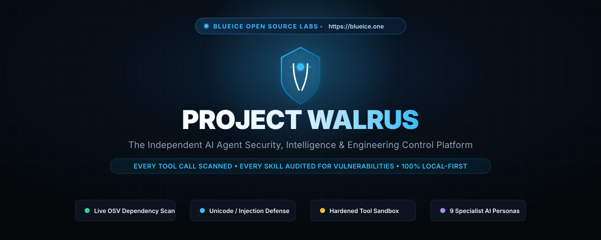
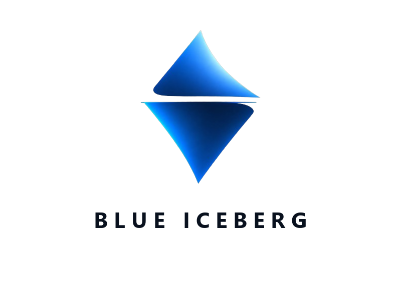

<p align="center">
  
</p>

<p align="center">
  <a href="https://blueice.one"></a>
</p>

<h1 align="center">Project Walrus</h1>

<p align="center">
  <strong>The Open Source Space for <a href="https://blueice.one">BlueIce</a></strong><br>
  <em>An Autonomous, Local-First AI Agent Security, Intelligence &amp; Engineering Control Platform</em>
</p>

<p align="center">
  <a href="https://blueice.one"></a>
  <a href="LICENSE"></a>
  <a href="dist/WALRUS-Setup-0.25.0-beta.exe"></a>
  
  <a href="#test-suite--verification"></a>
  
</p>

---

## ⚡ The Core Philosophy

> **"Your AI agents have terminal access, file system access, and network access. You deserve absolute oversight and deterministic protection."**

As AI coding agents (Anthropic Claude Code, Cursor, OpenAI Codex CLI, and Model Context Protocol MCP servers) take over everyday development, they execute shell commands, write code, install third-party dependencies, and invoke tools autonomously.

**Project Walrus** is an independent, local-first control and intelligence layer that runs alongside developer workflows.

### 🛡️ Non-Negotiable Security Guarantees
* **🔍 Every Tool Call is Scanned:** No bash execution, file modification, or network socket is spawned blindly. Every tool call is intercepted, normalized into an 18-field versioned event schema, and evaluated against strict deterministic policy rules before execution.
* **🧬 Every Skill & Instruction is Audited:** Agent skill files (`SKILL.md`), prompt files (`.cursorrules`, `CLAUDE.md`, instructions), and MCP manifests are audited for prompt injections, credential exfiltration webhooks, zero-width steganography, Trojan Source bidirectional overrides, and destructive shell payloads.
* **🌐 Real-Time Google OSV Dependency Scanning:** Live batch querying across npm, Python, Rust, and Go manifests directly against the Google Open Source Vulnerabilities database (`api.osv.dev`), attributing exact CVE/GHSA IDs, risk scores, and upgrade paths.
* **🔒 Canonical Zero-Trust Workspace Sandbox:** Tool brokers enforce canonical native path resolution (`realpathSync.native`), completely eliminating sibling directory bypasses, symlink escapes, junction redirections, and path traversals.
* **🤖 Engineering Intelligence & Automated Code Review:** Synthesizes Git diffs, measures architectural blast radius across dependencies, detects line-level anti-patterns, and proposes automated unified diff patches with instant pre-patch backup rollback.

---

## 🏛️ Name Affiliation & Open Source Licensing

**Project Walrus** is proudly maintained as an open-source initiative by **[BlueIce](https://blueice.one)** (The Blue Iceberg enterprise AI engineering and research lab).

* **Source Code License:** The software is open-sourced under the **[MIT License](LICENSE)**. You are free to inspect, run, modify, extend, distribute, and integrate Project Walrus into your own developer tools or enterprise pipelines.
* **Name & Trademark Affiliation:** "BlueIce", "The Blue Iceberg", and the BlueIce logo are marks of [BlueIce](https://blueice.one). "Project Walrus" denotes this official open-source distribution. Third-party forks or distributions may not use the BlueIce name or trademarks to imply commercial endorsement without written authorization from BlueIce.

---

## 🌟 Key Features & Subsystems

```
┌─────────────────────────────────────────────────────────────────────────────┐
│                            PROJECT WALRUS CORE                              │
├──────────────────────────────┬──────────────────────────────┬───────────────┤
│    AGENT OBSERVABILITY       │     SECURITY & SCANNING      │ ENGINEERING   │
│  • Claude Code (Hooks/Bash)  │  • Every Tool Call Scanned   │  • Git Diffs  │
│  • Cursor IDE & Processes    │  • Every Skill Scanned       │  • Blast-     │
│  • OpenAI Codex CLI          │  • Google OSV Live CVE/GHSA  │    Radius     │
│  • Model Context Protocol    │  • Zero-Width & Unicode Evas │  • Automated  │
│  • Toolhelp32 Process Trees  │  • Machine-Bound AES-256-GCM │    Reviews    │
├──────────────────────────────┴──────────────────────────────┴───────────────┤
│                             AI ORCHESTRATION                                │
│   9 Specialist Roles • Bounded Tool Broker • Local Ollama Zero-Egress       │
├─────────────────────────────────────────────────────────────────────────────┤
│                          PERSISTENCE & FRONTEND                             │
│  Transactional SQLite WAL Mode • Svelte 5 Observatory • Unslop Design System│
└─────────────────────────────────────────────────────────────────────────────┘
```

### 1. Security Intelligence & Threat Detection
- **Prompt Injection Defense:** Multi-pass normalization detecting hidden zero-width spaces (`\u200B-\u200D\uFEFF\u2060\u180E`), Trojan Source bidirectional overrides (`\u202A-\u202E\u2066-\u2069`), NFKC canonical equivalences, and Cyrillic/Greek homoglyphs without false positives on legitimate multilingual code.
- **Repository Secret Hunter:** Scans directories for committed `.env` files, RSA/SSH private keys, GitHub PATs, AWS secrets, OpenAI, and Anthropic tokens.
- **MCP Server Configuration Scanner:** Audits `claude_desktop_config.json`, `cursor_mcp.json`, and stdio server arguments for risky command invocations and root directory exposures.

### 2. Engineering Intelligence & Autonomous Code Review
- **Git Context Engine:** Seamlessly switches review scopes: `staged`, `unstaged`, `HEAD~1`, or custom diff text.
- **Architectural Blast Radius:** Traverses project imports and package dependencies to calculate architectural risk levels (`LOW`, `MEDIUM`, `HIGH`, `CRITICAL`) and predict downstream regression risk.
- **Remediation Engine:** Proposes minimal unified diff patches for detected vulnerabilities, performs dry-run validation, and maintains automatic pre-patch backups for guaranteed one-click rollbacks.

### 3. 9 Autonomous Specialist Agent Personas
Configured with dedicated system prompts, strict tool permissions, and bounded budgets in [`src/main/ai/specialist-agents.js`](src/main/ai/specialist-agents.js):
1. **Security Analyst:** Investigates suspicious prompts, instruction injections, tool calls, and anomalous runtime behaviors.
2. **Code Reviewer:** Conducts principal-level contextual diff reviews for logic flaws, security vulnerabilities, and regressions.
3. **Threat Investigator:** Correlates disparate event streams to reconstruct multi-step attack chains.
4. **Repository Analyst:** Evaluates architectural integrity, directory boundaries, and configuration safety.
5. **Dependency Analyst:** Assesses CVE/GHSA exploitability, transitive dependencies, and safe upgrade paths.
6. **Architecture Analyst:** Analyzes component coupling, API contracts, and downstream blast radiuses.
7. **Remediation Agent:** Generates surgical unified diff patches to resolve verified findings.
8. **QA Agent:** Generates reproducible automated test cases to prevent regressions.
9. **Policy Analyst:** Synthesizes observations into refined Observe/Warn/Approve/Block deterministic policies.

### 4. 100% Local-First & Zero Egress by Default
- **Local LLM Execution:** First-class support for local Ollama instances (`http://localhost:11434`), ensuring zero outbound bytes leave your workstation.
- **Outbound Data Egress Guard:** When external providers (Anthropic, OpenAI) are selected, prompts, tool outputs, and diffs are automatically scrubbed of credentials and sensitive local file paths before transmission.
- **Machine-Bound AES-256-GCM:** API keys are stored encrypted on disk, derived using hardware and user environment entropy (`os.hostname()`, `os.userInfo().username`, `COMPUTERNAME`, `USERDOMAIN`).

---

## 🖥️ Observatory User Interface

The Project Walrus desktop interface is built using **Svelte 5 Runes** and engineered according to the **Unslop Design Standard**:
- Strict 4px typographic grid, dark obsidian slate palette (`#0c0d0e`), hairline borders (`rgba(255, 255, 255, 0.08)`), and tabular numerics (`font-variant-numeric: tabular-nums`).
- **Interactive Workspaces:**
  - 📡 **Monitoring & Process Radar:** Real-time visual monitoring of running AI agent processes, CPU/memory telemetry, and live activity feeds.
  - 📝 **Code Intelligence:** Scope-based code review, diff viewer, blast radius gauges, and patch proposal triggers.
  - 🔍 **AI Investigation Workspace:** Select specialist agent personas, execute ad-hoc forensic queries, view token consumption, and inspect root-cause analyses.
  - 🛡️ **Security Scanners:** One-click execution of Google OSV dependency scans, skill scans, and repo secret audits with SARIF and JSON export.
  - 🩹 **Remediation & Patch Review:** Inspect unified diffs, assess workspace boundaries, apply patches, and execute instant rollbacks.
  - 📜 **Audit & Tamper-Evident History:** Cryptographically verifiable hashchains for recorded activity and event timelines.

---

## 🚀 Getting Started

### Option A: Prebuilt Windows Installer (Recommended)

Download the official Windows installer:
* **Installer:** [`WALRUS-Setup-0.25.0-beta.exe`](dist/WALRUS-Setup-0.25.0-beta.exe) (~130 MB)
* Run the setup wizard to install Project Walrus with Start Menu and Desktop shortcuts.
* User settings and audit databases are preserved safely in `%APPDATA%\aegis`.

### Option B: Run from Source

#### Prerequisites
- **Node.js:** v22.17.0 or later (Node 24 compatible)
- **NPM:** v10.9.0 or later
- **Operating System:** Windows 10 / Windows 11 (x64)

#### 1. Clone the Repository
```bash
git clone https://github.com/antropos17/Aegis.git walrus
cd walrus
```

#### 2. Install Dependencies
```bash
npm install
```

#### 3. Build the Frontend Renderer
```bash
npm run frontend:build
```

#### 4. Launch the Desktop Application
```bash
npm start
```

---

## 🧪 Test Suite & Verification

Project Walrus maintains a comprehensive test suite covering security sandboxing, evasion defense, OSV integration, and persistence:

```powershell
# Run the complete Project Walrus security and platform test suite:
$env:AEGIS_SKIP_ELECTRON_PREPARE="1"; $env:AEGIS_ALLOW_NODE_OVERRIDE="1"; npx vitest run tests/main/tool-broker-security.test.js tests/main/unicode-normalization-injection.test.js tests/main/security-scanners.test.js tests/main/ai-reasoning-and-orchestration.test.js tests/main/database-and-events.test.js tests/main/policy-and-remediation.test.js tests/main/agent-connectors.test.js tests/main/code-review-and-context.test.js tests/main/security-provenance-and-risk.test.js
```

### Empirical Test Results:
```
 ✓  main  tests/main/policy-and-remediation.test.js (5 tests)
 ✓  main  tests/main/tool-broker-security.test.js (17 tests)
 ✓  main  tests/main/database-and-events.test.js (8 tests)
 ✓  main  tests/main/unicode-normalization-injection.test.js (8 tests)
 ✓  main  tests/main/security-scanners.test.js (6 tests)
 ✓  main  tests/main/ai-reasoning-and-orchestration.test.js (6 tests)
 ✓  main  tests/main/agent-connectors.test.js (4 tests)
 ✓  main  tests/main/code-review-and-context.test.js (3 tests)
 ✓  main  tests/main/security-provenance-and-risk.test.js (6 tests)

 Test Files  9 passed (9)
      Tests  63 passed (63)
   Duration  4.25s
   Pass Rate 100.0%
```


---

## 🗺️ Roadmap & TODO

### ✅ Completed Milestones
- [x] **Tool Broker Containment:** Replaced string prefixes with canonical native path resolution (`realpathSync.native`), ancestor walking, and device namespace blocks (17/17 adversarial bypass tests passing).
- [x] **Unicode & Injection Hardening:** Implemented zero-width space stripping, Trojan Source bidirectional override detection, and Cyrillic/Greek homoglyph normalization.
- [x] **Live Dependency Scanning:** Integrated Google OSV batch API (`api.osv.dev/v1/querybatch`) for npm, pip, cargo, and go manifests.
- [x] **Machine-Bound Key Security:** AES-256-GCM master keys bound to workstation entropy with automatic legacy key migration.
- [x] **Outbound Data Egress Guard:** Automated credential and local path redaction before external LLM dispatch.
- [x] **Observatory UI Integration:** Built and wired interactive Svelte 5 views for Code Intelligence, AI Investigations, Scanner Management, and Remediation.
- [x] **Production Windows Packaging:** Configured and generated a 130 MB NSIS installer wizard with shortcut management and data retention.

### 📌 In Progress & Upcoming (TODO)
- [ ] **Cross-Platform Kernel Monitoring:**
  - [ ] Linux eBPF telemetry sensor for system-call and network socket monitoring without performance degradation.
  - [ ] macOS Endpoint Security (ESF) event tap for Apple Silicon Darwin environments.
- [ ] **Deep IDE Integrations:**
  - [ ] VS Code / Cursor dedicated extension to surface real-time Walrus threat verdicts and tool-call approvals directly in the editor status bar.
  - [ ] JetBrains IDE plugin for inline code review findings.
- [ ] **Multi-Agent Cooperative Red-Teaming:**
  - [ ] Autonomous Red-Team Specialist Persona designed to simulate complex multi-stage prompt injections against configured skills before deployment.
- [ ] **CI/CD Security Gate Bot:**
  - [ ] GitHub Actions / GitLab CI runner that invokes the Walrus Scanner Engine to block PRs containing malicious skills, unpinned vulnerable dependencies, or prompt injections.
- [ ] **Fine-Grained Network Egress Firewall:**
  - [ ] Windows Filtering Platform (WFP) user-mode driver to intercept and block unauthorized outbound HTTP/DNS requests made by subagent processes.

---

## 🤝 Contributing

We welcome contributions from developers, security researchers, and systems architects! 

### How to Contribute
1. **Fork the Repository:** Create a feature branch (`git checkout -b feature/amazing-scanner`).
2. **Coding Standards:**
   - Adhere to the established [Coding Standards](CODING_STANDARDS.md).
   - Use strict workspace boundary checks (`fs.realpathSync.native`) for any file operations.
   - All UI code in `frontend/observatory` must use Svelte 5 Runes and follow the `unslop` design tokens.
3. **Write Tests:** Add unit and integration tests under `tests/main/` or `tests/renderer/`.
4. **Verify Test Passes:** Ensure all 63 platform tests pass (`npx vitest run ...`) and `npm run frontend:build` compiles cleanly.
5. **Open a Pull Request:** Describe your changes, security implications, and test evidence.

### Reporting Security Vulnerabilities
If you discover a security vulnerability or bypass in Project Walrus, please report it privately via email to **security@blueice.one** rather than opening a public issue. We appreciate responsible disclosure.

---

## 🌐 Community & Links

* **Official Website:** [https://blueice.one](https://blueice.one)
* **Join the Builders Community:** [blueice.one#builders-community](https://blueice.one)
* **License:** [MIT License](LICENSE)

<p align="center">
  <sub>Built with care by <a href="https://blueice.one">BlueIce</a> and the open-source community.</sub>
</p>
